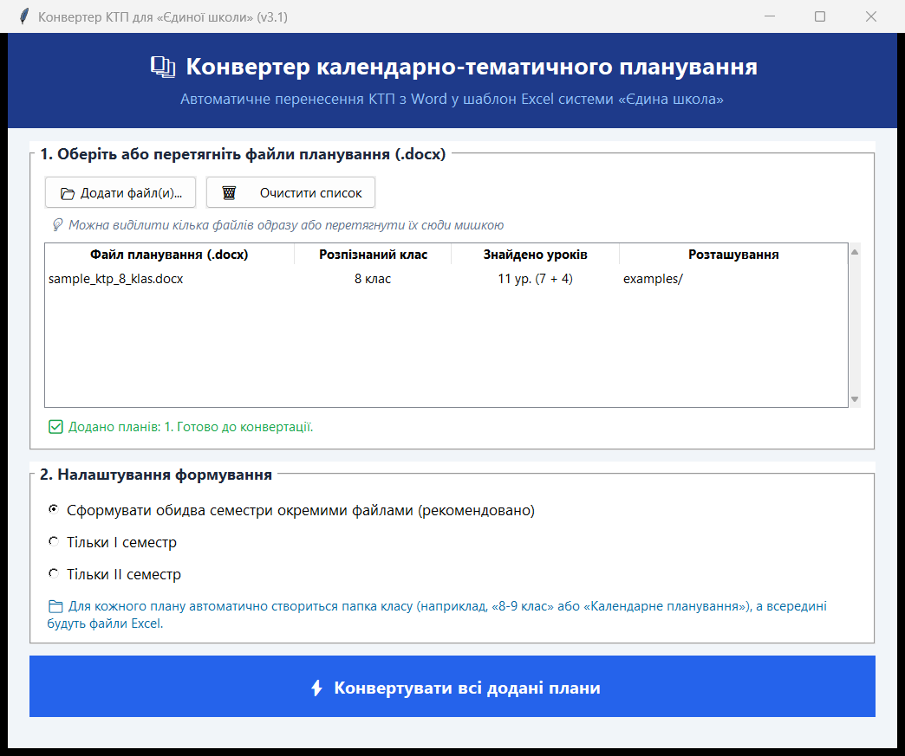

[Українською](README.md)

# KTP Document Converter

Desktop Python utility for batch-converting Ukrainian school calendar-thematic plans (КТП) from Word `.docx` tables into the `.xlsx` import template used by «Єдина школа».



## Features

- Batch `.docx` to `.xlsx` conversion with per-semester lesson count preview
- File picker and Windows Drag & Drop (`windnd`) with UTF-8 / `cp1251` path handling
- Semester detection across Cyrillic (`І`, `ІІ`), Latin (`I`, `II`), and numeric formats
- Automatic grade detection from document paragraphs or filenames (`8 клас`, `8-9 клас`, etc.)
- Row style cloning when a semester contains more than the 100 pre-formatted template rows
- High-DPI scaling on Windows and standalone `.exe` packaging via PyInstaller

## Quick Start

Prebuilt Windows binaries (`KTP_Converter_v3.1.0.exe`) are available in [Releases](https://github.com/MarianZaiachuk/ktp-document-converter/releases/latest).

Run from source:

```bash
git clone https://github.com/MarianZaiachuk/ktp-document-converter.git
cd ktp-document-converter
python -m venv .venv
.venv\Scripts\activate
pip install -r requirements.txt
python gui_app.py
```

Or double-click `Запустити.bat` on Windows. Placing a custom `topics-template.xlsx` in the working directory overrides `templates/topics-template.xlsx`.

## Examples

Sample input and generated output files are in [`examples/`](examples/):

- [`examples/sample_ktp_8_klas.docx`](examples/sample_ktp_8_klas.docx)
- [`examples/sample_ktp_8_klas_1_sem.xlsx`](examples/sample_ktp_8_klas_1_sem.xlsx)
- [`examples/sample_ktp_8_klas_2_sem.xlsx`](examples/sample_ktp_8_klas_2_sem.xlsx)

## Build & Tests

```bash
pip install -r requirements-dev.txt
pytest -v
python build_exe.py
```

## License

[MIT](LICENSE)
