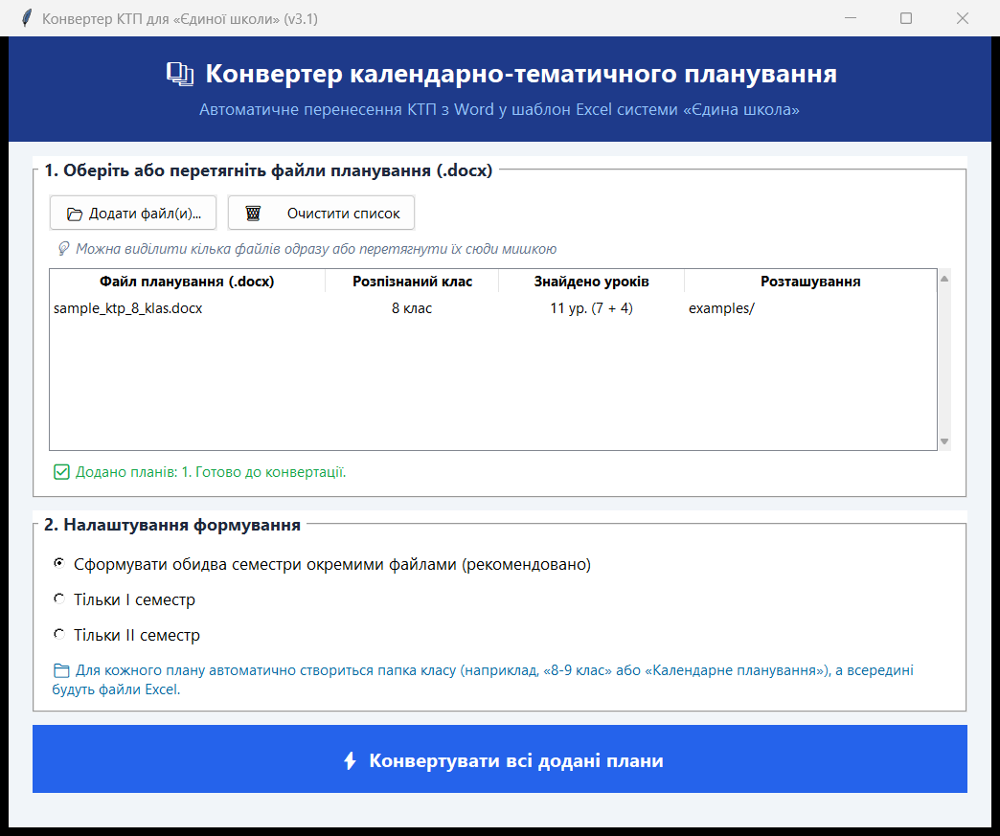

[English](README.en.md)

# Конвертер КТП для «Єдиної школи»

Десктопна утиліта на Python для перенесення календарно-тематичних планів із таблиць Word (`.docx`) у шаблон Excel (`.xlsx`) для завантаження в «Єдину школу».



## Можливості

- Пакетна конвертація кількох `.docx` файлів одночасно з попереднім переглядом кількості уроків по семестрах
- Додавання файлів через діалог або перетягуванням мишкою (Drag & Drop через `windnd`, з підтримкою кириличних шляхів у Windows)
- Розпізнавання заголовків семестрів у кириличному (`І`, `ІІ`), латинському (`I`, `II`) та цифровому (`1 семестр`, `2-й семестр`) форматах
- Автоматичне визначення класу з тексту або назви файлу і сортування готових `.xlsx` по окремих папках (`8 клас`, `8-9 клас` тощо)
- Копіювання стилів шаблону, якщо в семестрі більше 100 уроків
- Підтримка High-DPI у Windows та збірка в автономний `.exe`

## Встановлення та запуск

Готовий `KTP_Converter_v3.1.0.exe` для Windows без потреби встановлювати Python є на сторінці [Releases](https://github.com/MarianZaiachuk/ktp-document-converter/releases/latest).

Запуск із вихідного коду:

```bash
git clone https://github.com/MarianZaiachuk/ktp-document-converter.git
cd ktp-document-converter
python -m venv .venv
.venv\Scripts\activate
pip install -r requirements.txt
python gui_app.py
```

Також у Windows можна запустити через `Запустити.bat`. Якщо покласти власний `topics-template.xlsx` поруч із програмою, вона використає його замість стандартного шаблону з `templates/topics-template.xlsx`.

## Приклади

У папці [`examples/`](examples/) лежить зразок вхідного плану та згенеровані Excel-файли:

- [`examples/sample_ktp_8_klas.docx`](examples/sample_ktp_8_klas.docx)
- [`examples/sample_ktp_8_klas_1_sem.xlsx`](examples/sample_ktp_8_klas_1_sem.xlsx)
- [`examples/sample_ktp_8_klas_2_sem.xlsx`](examples/sample_ktp_8_klas_2_sem.xlsx)

## Збірка `.exe` та тести

```bash
pip install -r requirements-dev.txt
pytest -v
python build_exe.py
```

Або через `Створити_EXE.bat`. Скрипт пакує `gui_app.py`, `converter.py` і `templates/topics-template.xlsx` в один файл `Конвертер_КТП.exe`.

## Ліцензія

[MIT](LICENSE)
